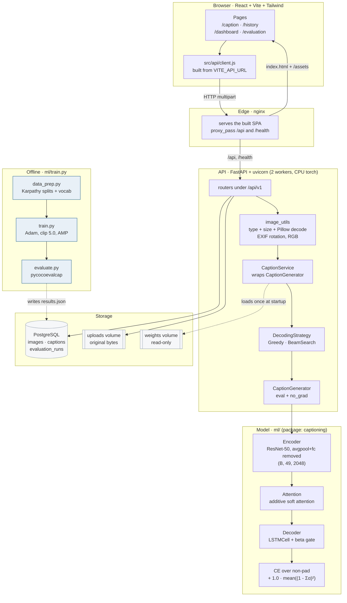

# Lumina — Attention-Based Image Captioning with AI Visual Understanding

An image captioning system built on a CNN Encoder + Soft Attention + LSTM Decoder
(the "Show, Attend and Tell" architecture), extended into three guided analysis
modes: **Museum AI**, **Prescription AI**, and **Product Label AI**.

## Architecture



Data path for one upload: browser → nginx → `POST /api/v1/captions` →
Pillow validation → ResNet-50 gives 49 region features → additive attention
selects a weighted context per word → LSTMCell decodes (greedy or beam) →
attention reshaped to `num_words × 7 × 7` → row persisted → returned.

## What it does

1. Upload an image (JPEG/PNG).
2. The model generates a natural-language caption, with a per-word attention
   heatmap showing what it focused on while generating each word.
3. Pick an analysis mode for a deeper, plain-language explanation:
   - **Museum AI** — artwork/artifact history, grounded with RAG (FAISS)
   - **Prescription AI** — medicine, dosage, and frequency from a handwritten prescription (OCR)
   - **Product Label AI** — ingredients, allergens, and a health score (OCR)

## Tech stack

- **Model**: PyTorch, Torchvision (ResNet encoder)
- **Backend**: FastAPI, PostgreSQL, SQLAlchemy
- **OCR**: PaddleOCR / EasyOCR
- **RAG**: FAISS + LangChain
- **LLM**: OpenAI / Llama / Gemma (swappable)
- **Frontend**: React + Tailwind CSS

## Project structure

```
ml/                      Model package (pip-installable as `captioning`)
  pyproject.toml
  requirements.txt
  captioning/            data, vocab, encoder, attention, decoder, decoding, metrics, generator
  notebooks/             captioning_Image.ipynb, 02_train_kaggle.ipynb
  tests/
  train.py  data_prep.py  evaluate.py
backend/                 FastAPI service — captioning, OCR, RAG, LLM, analyzers
  requirements.txt
  .env.example
  app/
    main.py, schemas.py
    api/v1/  services/  db/  core/
  tests/
frontend/                Vite + React + Tailwind UI
  src/api/client.js      the only module that talks to the backend
  src/pages/             caption, history, dashboard, evaluation
  src/components/        dropzone, word list, canvas overlay, skeleton
data/                    MS COCO 2014 + Karpathy split (git-ignored)
ml/weights/              checkpoints (git-ignored)
```

Notebooks:

| Notebook | Purpose |
|---|---|
| `ml/notebooks/captioning_Image.ipynb` | Original Colab walkthrough of the model parts |
| `ml/notebooks/02_train_kaggle.ipynb` | End-to-end training on Kaggle: install, splits, train, resume, plot, evaluate |

## Setup

```bash
# 1. Environment
cp .env.example .env   # add your LLM API key + DB URL

# 2. ML package (installable so the backend can `import captioning`)
pip install -r ml/requirements.txt
pip install -e ./ml

# 3. Backend
pip install -r backend/requirements.txt

# 4. Build the splits, then train (or drop a checkpoint into ml/weights/)
python3 -m ml.data_prep \
    --karpathy-json data/dataset_coco.json \
    --coco-root data/coco \
    --out-dir data/processed

python3 -m ml.train \
    --coco-root data/coco \
    --data-dir data/processed \
    --out-dir ml/weights \
    --epochs 5 --batch-size 32 --amp

# 5. Run the API
uvicorn backend.app.main:app --reload

# 6. Frontend
cd frontend
npm install
npm run dev
```

## API

| Method | Path | Purpose |
|---|---|---|
| `GET` | `/health` | Liveness plus whether the model loaded |
| `POST` | `/api/v1/captions` | Upload an image, get a caption + attention map (201) |
| `GET` | `/api/v1/captions` | History, newest first; `limit`, `offset`, `q` |
| `GET` | `/api/v1/captions/{id}` | One caption |
| `GET` | `/api/v1/images/{id}` | The stored upload |
| `GET` | `/api/v1/stats` | Totals, mean generation time, latest evaluation |

```bash
curl -F file=@photo.jpg http://localhost:8000/api/v1/captions   # -> 201
```

The response carries `caption`, `words`, `attention` shaped
`num_words x 7 x 7`, `time_ms` and `image_url`. Attention rows sum to 1.

Errors are always `{"detail": "..."}`: `400` for a non-image or corrupt upload,
`413` above 10 MB, `404` for an unknown id, `503` when the model is not loaded.

Configure with environment variables — see `backend/.env.example`. The defaults
are SQLite at `./app.db` and `CHECKPOINT_PATH=ml/weights/best.pt`. For
PostgreSQL set `DATABASE_URL=postgresql+psycopg://user:pw@host:5432/lumina`;
the models use portable types, so the same code creates the schema on either.

```bash
pytest backend/tests   # fake generator, no weights or download needed
```

## Deployment

```bash
cp .env.example .env      # set POSTGRES_PASSWORD — compose refuses without it
docker compose up --build
open http://localhost:8080
```

Three containers: **nginx** serves the built SPA and proxies `/api` and
`/health` to the backend, **api** runs uvicorn with 2 workers on CPU-only torch,
**postgres** holds the data.

| Service | Port published | Notes |
|---|---|---|
| nginx | `${WEB_PORT:-8080}` | the only service reachable from the host |
| api | none | reachable only through nginx |
| postgres | none | never published |

Security properties, each verifiable in the config:

- The Postgres password comes from `.env` and is interpolated at compose time, so
  it exists in no image layer. `POSTGRES_PASSWORD` has no default and compose
  fails fast rather than starting with a guessable credential.
- `.dockerignore` keeps `.env`, `data/` and `ml/weights/` out of the build context.
- The weights volume is mounted read-only (`:ro`).
- The api container runs as a non-root user (uid 10001).
- PostgreSQL data lives in a named volume, not a bind mount.

The API starts **degraded** with no checkpoint: captions return 503 and the
frontend says why, so the stack comes up before a model exists. Seed one and
reload:

```bash
docker compose cp ml/weights/best.pt api:/app/weights/best.pt
docker compose restart api
```

Both images build from the repo root as context. Build them directly with:

```bash
docker build -f backend/Dockerfile -t lumina-api .
docker build -f frontend/Dockerfile -t lumina-frontend .
```

## Frontend

```bash
cd frontend
npm install
cp .env.example .env   # VITE_API_URL, defaults to http://localhost:8000
npm run dev
```

| Route | Page |
|---|---|
| `/caption` | Upload by drag-and-drop or button, then read the caption |
| `/history` | Past captions with search; a row reopens it on `/caption` |
| `/dashboard` | Totals, mean inference time, latest BLEU-4 |
| `/evaluation` | Placeholder |

Selecting a caption word (click, or the Left/Right arrow keys) draws that word's
7×7 attention grid as a smooth heatmap over the image on a canvas. Words are
real buttons, the group is a single tab stop, and a polite live region announces
the selection.

```bash
npm test    # 67 Vitest tests
npm run lint
```

## Training options

```bash
# quick sanity check: overfit 8 images with one caption each, print the results
python3 -m ml.train --coco-root data/coco --data-dir data/processed \
    --out-dir /tmp/overfit --overfit 8 --epochs 100

# first N training images only
python3 -m ml.train ... --subset 20000

# unfreeze encoder layer3/layer4 at epoch 3 (encoder runs at lr 1e-4)
python3 -m ml.train ... --finetune-after 3

# resume after an interruption (restores model, optimiser, epoch, best score)
python3 -m ml.train ... --resume ml/weights/last_state.pt
```

`ml/notebooks/02_train_kaggle.ipynb` drives all of this on a Kaggle GPU runtime,
including the split building, a resume cell for the 12-hour cutoff, and a plot of
`metrics.csv`.

`scripts/check_notebook.py` statically validates a notebook — every Python cell
parses and every name is defined by an earlier cell:

```bash
python3 scripts/check_notebook.py ml/notebooks/02_train_kaggle.ipynb
```

`--overfit` uses the eval transform and a single fixed caption per image, so
nothing varies between passes — it is a pipeline check, not a training run.
The `val BLEU-4` printed per epoch is an nltk proxy over greedy decoding on a
fixed 1000-image validation sample; `ml/evaluate.py` produces the real
numbers. `last.pt` and `best.pt` follow the checkpoint contract, with
`vocab.json` and `metrics.csv` alongside them.

## Inference

```python
from captioning.generator import CaptionGenerator
from captioning.decoding import BeamSearchDecodingStrategy

generator = CaptionGenerator("ml/weights/best.pt", device="cpu")
result = generator.generate(Image.open("photo.jpg"))

result.caption    # "a dog runs across the grass"
result.words      # ["a", "dog", "runs", "across", "the", "grass"]
result.attention  # numpy (num_words, 7, 7), each row sums to 1
result.time_ms    # encode + decode wall clock
```

Swap in beam search by passing a strategy built from the loaded decoder:

```python
from captioning.model import load_checkpoint

model, vocab, meta = load_checkpoint("ml/weights/best.pt")
strategy = BeamSearchDecodingStrategy(model.decoder, beam_size=5)
generator = CaptionGenerator("ml/weights/best.pt", strategy=strategy)
```

`DecodingStrategy` is the extension point: implement `decode(features) ->
(token_ids, alphas)` to add your own search. Both built-ins stop at `<end>` or
`max_len` (50) and return the attention for the sequence they chose.

Beam search ranks beams by summed log-probability by default, which favours
short captions. Pass `length_penalty=1.0` to divide by length instead, or
`0.5` for a milder correction.

## Evaluation

```bash
# score the Karpathy test split (needs pycocoevalcap; pip install -r ml/requirements.txt)
python3 -m ml.evaluate \
    --checkpoint ml/weights/best.pt \
    --data-dir data/processed \
    --coco-root data/coco \
    --split test \
    --beam-size 3 \
    --out results.json
```

Reports BLEU-1..4, METEOR and CIDEr, prints the 10 best and 10 worst captions by
CIDEr, and writes every generated caption next to all of its references into
`results.json` along with the model config and decoding settings.

Captions are tokenised with `PTBTokenizer` (needs a JVM, same as the COCO
leaderboard). Without Java it falls back to lower-casing and whitespace
splitting, and says so in both the console output and `results.json` — BLEU and
METEOR shift slightly between the two. Add `--limit N` for a quick pass and
`--beam-size 0` to score greedy decoding instead of beam search.

| Module | Metric | Target |
|---|---|---|
| Captioning | BLEU-4, CIDEr, METEOR | CIDEr ≥ 1.0, BLEU-4 ≥ 0.30 |
| Museum AI | Human-in-the-Loop grounding review | 90% grounded |
| Prescription AI | OCR CER/WER + field accuracy | 80% correct extraction |
| Product Label AI | OCR CER/WER + coverage | 90% readable labels processed |

## Results

**Placeholders — no trained checkpoint has been scored yet.** Fill these in from
`results.json` after `python3 -m ml.evaluate` (see [Evaluation](#evaluation)).

Corpus metrics on the Karpathy **test** split (5,000 images, beam search k=3,
`PTBTokenizer`):

| Metric | Target | Measured | Split | Checkpoint |
|---|---|---|---|---|
| BLEU-4 | ≥ 0.30 | _TBD_ | test | _TBD_ |
| METEOR | — | _TBD_ | test | _TBD_ |
| CIDEr | ≥ 1.00 | _TBD_ | test | _TBD_ |
| BLEU-1 / BLEU-2 / BLEU-3 | — | _TBD_ | test | _TBD_ |

Latency, CPU deployment (`docker compose`, 2 uvicorn workers, no GPU):

| Metric | Target | Measured | Notes |
|---|---|---|---|
| Caption latency (p50) | ≤ 2000 ms | _TBD_ | `time_ms` returned by `POST /api/v1/captions` |
| Caption latency (p95) | — | _TBD_ | |
| Attention rows sum to 1 | ± 1e-4 | _asserted by TEST-02_ | every word, every image |

The 2000 ms latency target is the one TEST-05 asserts against; it is set in
`backend/tests/test_prd.py` as `LATENCY_TARGET_MS` and guarded by its own test so
it cannot silently drift.

## PRD acceptance tests

The five requirements below have dedicated, individually runnable tests in
[`backend/tests/test_prd.py`](backend/tests/test_prd.py).

| ID | Requirement | Test | Selector |
|---|---|---|---|
| **TEST-01** | Encoder output shape is `(1, 49, 2048)` | `test_TEST_01_encoder_output_shape` | `pytest -m "prd and test_01"` |
| **TEST-02** | Attention weights sum to 1 within `1e-4` | `test_TEST_02_attention_weights_sum_to_one` | `pytest -m "prd and test_02"` |
| **TEST-03** | A generated caption is persisted | `test_TEST_03_caption_is_persisted` | `pytest -m "prd and test_03"` |
| **TEST-04** | A corrupt upload returns `400` | `test_TEST_04_corrupt_upload_returns_400` | `pytest -m "prd and test_04"` |
| **TEST-05** | A caption completes within the latency target | `test_TEST_05_caption_within_latency_target` | `pytest -m "prd and test_05"` |

```bash
pytest -m prd            # all five, 18 tests
pytest -m "prd and test_03"
```

Use the marker, not `pytest -k TEST-03`: pytest parses the hyphen in a `-k`
expression as subtraction, so `-k TEST-03` **selects nothing and silently
passes**. The underscored `-k TEST_03` form also works.

TEST-01, TEST-02 and TEST-04 are additionally covered next to the code they
exercise (`ml/tests/test_model.py`, `ml/tests/test_decoding.py`,
`backend/tests/test_api.py`); `test_prd.py` is the single place to see the five
requirements as a set. CI reports each one as a separate job step, so a
regression names the requirement it broke.

## Continuous integration

`.github/workflows/ci.yml` runs on every push and pull request:

| Job | What it does |
|---|---|
| `lint` | `ruff check` over `ml/`, `backend/`, `scripts/` |
| `python` | pytest for ml and backend on Python 3.10 **and** 3.12, CPU-only torch |
| `prd` | the five PRD acceptance tests, one step per requirement |
| `frontend` | oxlint, 67 Vitest tests, production build |
| `docker` | builds both images, validates `docker-compose.yml` |

Torch comes from the CPU wheel index, which is resolved separately from PyPI
because `--index-url` replaces PyPI rather than adding to it. `ruff format` is
available but not enforced; adopting it would rewrite 23 existing files.

```bash
# run the same gates locally
ruff check .
pytest ml/tests backend/tests
pytest -m prd
cd frontend && npm test && npm run build
```

## Status

🚧 In progress — core captioning model training, analysis modes being built out.

## Based on

"Show, Attend and Tell: Neural Image Caption Generation with Visual Attention"
(Xu et al., ICML 2015)
